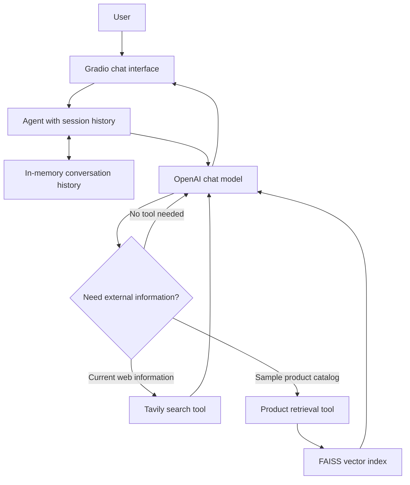
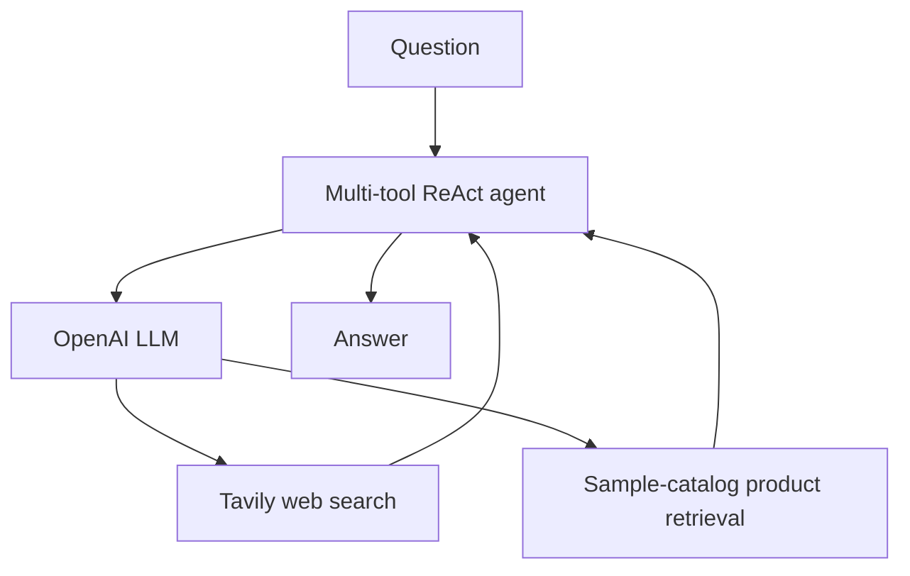
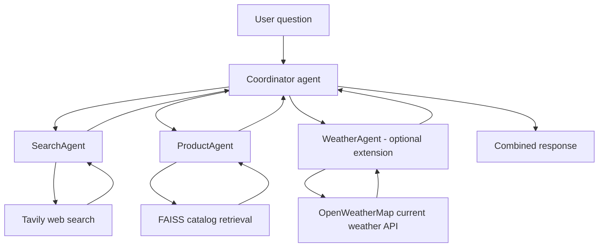

Agentic AI Product Discovery Assistant
A hands-on exploration of retrieval-augmented generation (RAG), tool-using AI agents, conversational memory, and multi-agent orchestration.
This project develops a product discovery assistant in Google Colab. It starts with a product-search chatbot grounded in a sample product catalog, adds real-time web search through Tavily, introduces session-based conversational memory and a Gradio interface, and then explores tool-based and coordinator-based agent architectures using LangChain, LangGraph, and OpenAI models.
> **Project status:** Educational prototype / work in progress. The notebook contains demonstrations of both single-agent and multi-agent designs. Some advanced tool calls have been slow or interrupted during testing, so the full notebook should **not** be treated as an end-to-end validated application. 
This repository is a learning prototype, not a validated production service. In the latest Colab notebook, OpenAI model connectivity and sample-catalog loading were demonstrated; the RAG/retriever needed reinitialization after runtime state was lost; a multi-tool comparison was interrupted after a long network wait; the coordinator and weather demonstrations are experimental / not confirmed end-to-end. The few-shot section includes commented-out example code and is not a verified working few-shot demonstration. The Gradio UI is present, but published availability is not implied.
Before running, users need their own OpenAI and Tavily credentials and the local `sample_dataset.csv`. The optional weather example needs an OpenWeatherMap key. No Anthropic key is necessary when using the OpenAI versions of the model cells, although an executable Anthropic test cell still remains in the uploaded notebook and should be deleted before publication.
Verify the safe minimum. Restart the runtime and test package imports, OpenAI setup, CSV loading, FAISS retriever creation, Tavily, and one single-agent query in sequence. Document any unverified optional steps.
Clear saved outputs and check permissions. Use Colab Edit → Clear all outputs (menu naming may vary), and inspect the saved `.ipynb` for keys, chat inputs, generated outputs, personal paths, and shared links. 
The guiding question behind this project is:
> How can a language-model-powered application select appropriate information sources and tools to answer product discovery questions, and how does that architecture change when work is delegated to multiple specialized agents?
This is a learning and demonstration project, not a production shopping application, Amazon integration, or a live purchasing system. The product search tool retrieves from a sample catalog; it does not query Amazon's live inventory, verify prices, or place orders.
Architecture at a glance
1. Single agent with tools, memory, and a Gradio UI

The agent receives the user's question, asks the LLM to select a tool when appropriate, retrieves information, and returns an answer. A session ID associates subsequent interactions with the same in-memory conversation history. The Colab notebook includes a custom `AgentExecutor`-style wrapper around a LangGraph agent to present results to the chat-history interface.
2. Single agent equipped with multiple tools

This example keeps one agent but equips it with more than one capability. The key distinction is that multi-tool does not automatically mean multi-agent.
3. Multi-agent coordinator

Here, the coordinator treats specialized agents as tools. The notebook first constructs a coordinator using search and product specialists, and later extends the example with a weather specialist. These later demonstrations are experimental and may require debugging, API configuration, and execution limits.
Core concepts
Concept	Role in the project	Easy way to remember
Large language model (LLM)	Interprets requests, generates responses, and selects tool calls	Brain
Prompt	Gives behavioral instructions and context	Instructions
Agent	Combines a model with an action/tool loop	Decision-maker
Tool	Allows a model-driven system to search or retrieve information	Hands
RAG	Retrieves relevant catalog text to ground a response	Reference library
Embedding	Represents text as vectors for semantic matching	Meaning-based coordinates
FAISS	Searches stored vectors for similar catalog passages	Search index
Conversation memory	Tracks messages within an active session	Notebook
ReAct	A repeated model decision → tool action → observation cycle	Think, act, check
Few-shot prompting	Supplies examples illustrating desired behavior	Worked examples
Coordinator	Routes tasks to specialist agents	Manager
Important distinctions: RAG is not itself an agent, and chat memory is not the same as a product knowledge base. FAISS stores a searchable index of product text; `RunnableWithMessageHistory` manages recent conversational messages. Neither is permanent, account-linked memory by default.
What the notebook implements
Phase 1 — Load and prepare product data
The sample product CSV includes fields such as `PRODUCT_ID`, `TITLE`, `BULLET_POINTS`, `DESCRIPTION`, and `PRODUCT_TYPE_ID`. The code combines the title and description into a text record for retrieval. Some descriptions are missing and need to be handled gracefully.
Phase 2 — Build a RAG search pipeline
Read product rows with pandas.
Convert titles and descriptions into product text.
Split the text with `RecursiveCharacterTextSplitter`.
Compute vector embeddings with `OpenAIEmbeddings`.
Index the document chunks in FAISS.
Expose the vector index as a retriever using `vector.as_retriever()`.
Provide retrieved context to an OpenAI chat model for answer generation.
The product retrieval tool is called `amazon_product_search` in the teaching notebook, but its search corpus is the provided sample product dataset, not a live Amazon API.
Phase 3 — Create agent tools
`search_tavily` calls Tavily for web search results. It is intended for current or externally sourced information.
`amazon_product_search` uses the RAG retriever to find relevant product descriptions in the local vector index.
`get_weather` is an optional later example using OpenWeatherMap to retrieve current weather (not forecasts).
The `@tool` decorator makes a Python function available as a callable tool for an agent. Tool execution happens when an agent invokes it, not merely when its function is defined.
Phase 4 — Single agent with conversational history
The notebook defines a ReAct-style prompt for teaching purposes and creates an agent with a chat model and the tools. It then demonstrates a custom executor wrapper and `RunnableWithMessageHistory`, keyed by `session_id`, so later messages can refer to earlier questions.
The agent's outputs and tools used can be inspected to understand its behavior. The chat history is stored in a Python dictionary and is lost when the runtime restarts.
Phase 5 — Gradio demo
A Gradio `Blocks` UI provides a text input, session ID field, response area, and clear-history action. This is an interactive chatbot demonstration, not a hosted production dashboard with authentication or persistent storage.
Phase 6 — Multi-tool agent and few-shot prompting
The notebook builds an agent with the web and product tools and asks product comparison questions (for example, MacBook Air versus Dell XPS). It contains a partially commented-out few-shot example; it is an educational draft rather than a verified executed few-shot agent.
The sample few-shot prices and descriptions in the code are illustrative examples, not verified, live offers.
Phase 7 — Coordinator-based multi-agent orchestration
A coordinator is created on top of a search specialist and a product specialist, both using an OpenAI chat model. Later, a weather specialist is added. Specialists are wrapped with `@tool` so the coordinator can delegate tasks to them.
The advanced demonstrations have shown long waits and interrupted execution while testing, so a successful run for every query is not yet established.
Technology stack
Technology	Usage
Python / pandas	CSV processing and experiment orchestration
Google Colab	Notebook development and execution
LangChain / LangChain Core	Prompts, tools, runnables, memory interface
LangGraph	Agent loops and coordinator-based designs
OpenAI / `langchain-openai`	Chat model and text embeddings
Tavily / LangChain community integration	Web search
FAISS / `faiss-cpu`	Local vector similarity search
Gradio	Interactive chat interface
OpenWeatherMap	Optional current-weather integration
Earlier versions of the teaching notebook used Anthropic Claude in some agent cells. For an OpenAI-only version, all active Claude model initialization and API testing cells should be replaced or removed. Do not imply that both model providers are required.
Data and retrieval pipeline
Expected primary file: `sample_dataset.csv`. At minimum, the code as written expects `TITLE` and `DESCRIPTION` columns. The original teaching data also includes other product attributes.
```text
sample_dataset.csv
   ↓
pandas DataFrame
   ↓
Title + Description text (missing values handled)
   ↓
Recursive text splitting
   ↓
OpenAIEmbeddings
   ↓
FAISS vector store
   ↓
Retriever
   ↓
amazon_product_search tool
   ↓
Agent → user-facing answer
```

Execution order
A frequent source of errors in the original notebook is using a variable before the cell that creates it has completed. The critical dependency order is:
```text
API credentials + installed packages
          ↓
Load sample_dataset.csv → df
          ↓
Build product_description
          ↓
Split into documents
          ↓
OpenAIEmbeddings → FAISS vector
          ↓
retriever = vector.as_retriever()
          ↓
Define search_tavily + amazon_product_search
          ↓
tools = [search_tavily, amazon_product_search]
          ↓
Initialize model → create agent
          ↓
Create history store / executor / memory wrapper
          ↓
Try single-agent queries + Gradio
          ↓
Next: multi-tool → coordinator → weather extension
```

Learning outcomes
By working through this notebook, the learner can explain:
How prompts and OpenAI models connect to an agent loop.
How to define Python tools with `@tool` and let an agent choose among them.
How RAG differs from live web search and from conversational memory.
How text chunking, embeddings, FAISS, and retrieval work together.
Why a single agent with two tools differs from a coordinator managing two or more specialist agents.
How session IDs and history wrappers maintain context during an active runtime.
Why dependency management, API credentials, execution limits, debugging, and secure publication matter for real AI applications.
Roadmap
Near term
[ ] Standardize active agent cells on OpenAI and remove unused Anthropic setup.
[ ] Make the notebook run top-to-bottom in a fresh Colab runtime.
[ ] Use a small, permitted sample dataset and configurable paths.
[ ] Add bounded agent execution, network timeouts, and clear debugging logs.
[ ] Validate the single-agent, Tavily, RAG, and Gradio examples individually.
Later enhancements
[ ] Add evaluation cases for relevance, hallucination, tool selection, and latency.
[ ] Add persistent conversation storage (for example, a database).
[ ] Add agent tracing and monitoring (for example, LangSmith or Langfuse).
[ ] Harden the coordinator and weather-tool integrations.
[ ] Add a deployable, authenticated interface and automated checks.


Acknowledgments and attribution
This project originated as an instructor-provided educational notebook and was adapted while learning the concepts and debugging the setup. 


Project takeaway: A single agent can use many tools; a multi-agent system delegates work to several specialized agents. The value comes from choosing the simplest architecture that solves the problem reliably.
